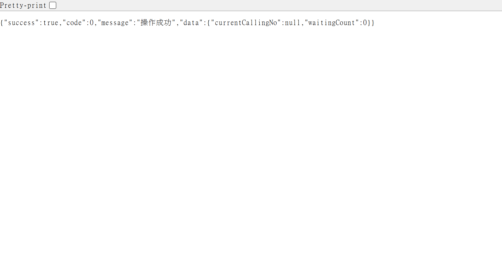
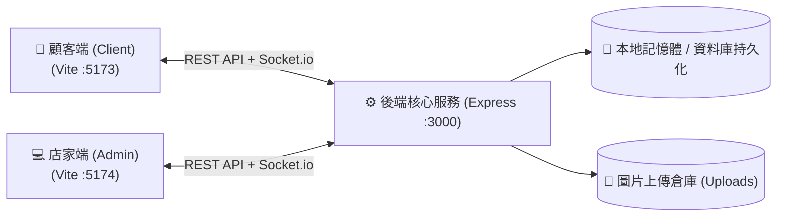

# ⚙️ QR Dine Server - 核心 API 與 WebSocket 伺服器

> QR Code 點餐系統的核心後端服務，提供高效的 RESTful API 與具備斷線自癒能力的 Socket.io 雙向推播架構。

---

## 📸 服務狀態與 API 檢驗 (API & Health Check)



---

## 🏛️ 系統架構與推播流程 (Architecture)



---

## ✨ 核心特色與技術架構

- 🚀 **RESTful API**：
  - `/api/menu`：菜單分類、餐點品項、規格選項 CRUD。
  - `/api/orders`：送出訂單、訂單追蹤、狀態流轉、現金結帳核銷。
  - `/api/queue`：顧客領取號碼牌、放棄排隊、後台唱號/叫號/入座流轉。
  - `/api/upload`：餐點照片上傳與靜態資源託管。
- ⚡ **Socket.io 高可用通訊（方案 B 規格）**：
  - **原生狀態恢復（Connection State Recovery）**：伺服器暫存 2 分鐘中斷狀態，手機黑屏喚醒 0 開銷自動恢復連線與漏推訊息。
  - **批次房間訂閱（`batch_join`）**：支援客戶端單一請求訂閱多個房間，避免 Wi-Fi 重連驚群風暴（減少 90% 封包）。
  - **靜默錯誤回收**：過濾客戶端切換 App 或手機鎖屏造成的 TCP `ECONNRESET`，保持終端機乾淨無雜訊。
- 🛡️ **資料防護與校驗**：全域使用 Zod 進行嚴格的請求參數驗證與型別保護。

---

## 🛠️ 技術棧 (Tech Stack)

- **核心執行環境**：Node.js (LTS)
- **Web 框架**：Express 4
- **開發語言**：TypeScript
- **即時通訊**：Socket.io 4.8
- **檔案處理**：Multer (圖片上傳處理)
- **校驗工具**：Zod
- **測試框架**：Playwright Test (整合 API 測試)

---

## 🚀 快速開始 (Getting Started)

### 1. 安裝依賴
```bash
npm install
```

### 2. 啟動開發伺服器 (支援熱重載)
```bash
npm run dev
```
服務將運行於：`http://localhost:3000`

### 3. 執行 API 自動化測試
```bash
npm test
```
*(包含訂單、排隊取號、菜單上下架、圖片上傳等 14 項正負向測試)*

### 4. 正式打包編譯
```bash
npm run build
```

